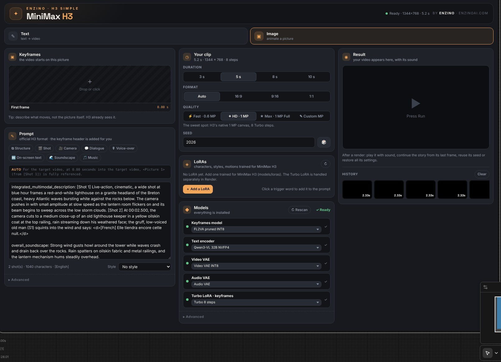
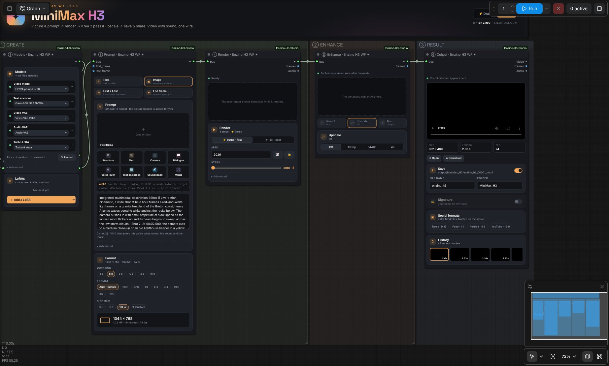
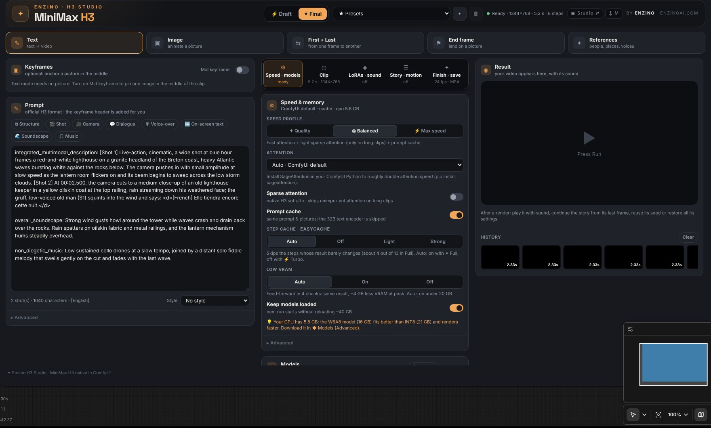

# ✦ Enzino H3 Studio

**MiniMax H3 dans ComfyUI, en simple.** Du texte, une image, deux images-clés, une image de fin ou des références en entrée, une vidéo avec **son stéréo natif** en sortie.

par **Enzino** · [enzinoai.com](https://enzinoai.com) · [Ko-Fi](https://ko-fi.com/enzinoxl/) · 🇬🇧 [Read in English](README.md) · 📖 [Guide complet](docs/guide.html)

Tout tourne sur l'implémentation MiniMax H3 native de ComfyUI : aucun code de modèle en plus, aucune dépendance Python en plus.

## Trois façons de l'utiliser

| | | |
|---|---|---|
|  | **✦ Enzino H3 Simple** | Une seule carte : image, prompt, durée, format, qualité, modèles et LoRAs. Tout le reste tourne sur son meilleur réglage automatique. Le plus court chemin vers un beau clip. |
|  | **✦ Enzino H3 WF** | Six étapes lisibles reliées par un seul fil : ① Modèles → ② LoRAs → ③ Prompt → ④ Rendu → ⑤ Amélioration → ⑥ Sortie, avec un bouton ⚡ Brouillon / ✦ Final dans l'en-tête. Ouvre `workflows/enzino_h3_wf.json`. |
|  | **✦ Enzino H3 Studio** | Tous les modes et tous les réglages dans un seul node en paysage, avec des onglets (Vitesse · Clip · LoRAs · Histoire · Finition) et le résultat toujours visible. |

Les trois partagent le même moteur : même qualité, même gestion de la vitesse et de la mémoire.

**Édition Free : ✦ Enzino H3 WF.** **Édition Full (11,99 $ sur [Ko-Fi](https://ko-fi.com/enzinoxl/)) : le WF, le node Simple et le Studio**, plus les outils de production ci-dessous.

## Ce qu'il y a dedans

| | |
|---|---|
| **Modes** | ✎ Texte · ▣ Image · ⇆ Début + Fin · ✦ Références (jusqu'à 9 images, citées dans le prompt) · ⚑ Image de fin (Studio) |
| **Prompt** | Format officiel H3. **L'en-tête image est écrit pour toi** (I2V, Début + Fin, Image de fin) avec le bon numéro de plan et le bon timing. **Aides au prompt** : de petits formulaires qui écrivent des phrases H3 correctes — ⧉ Structure, 🎬 Plan, 🎥 Caméra (18 mouvements), 💬 Dialogue et 🎙 Voix off (âge, voix, ton, langue, texte exact, S1/S2 suivis pour toi), 🔤 Texte à l'écran, 🌊 Ambiance, 🎵 Musique. Aperçu en direct, insertion au curseur |
| **Taille** | Par **budget de pixels**, comme le sélecteur officiel H3 : chaque format a le même nombre de pixels (1 MP ★ = 1344×768 en 16:9, 992×992 en 1:1…), ou ton propre budget de 0,3 à 3 MP |
| **Durée** | 1 à 15 s sur la grille d'images 17k+5 de H3, 24 i/s |
| **Modèles** | Tous les fichiers de tes dossiers sont sélectionnables (les modèles H3 sont reconnus par leur contenu, quel que soit leur nom). Les fichiers manquants et les autres versions (W6A8, FP8, Hybride FL+REF, VAE FP16…) se téléchargent depuis la liste, avec reprise |
| **LoRAs** | Tes LoRAs MiniMax H3 avec intensité et on/off, mots-clés à un clic. Free : 3 · Full : 8 |
| **Rendu** | ⚡ Turbo (LoRA Turbo 4/8 steps, ou un modèle déjà Turbo — pas besoin de LoRA) ou ✦ Full (13 steps avec cache, 20 sans) · seed 🎲 🔒 · **aperçu en direct** de tout le clip pendant le calcul |
| **Vitesse** | Attention auto (la plus rapide installée : SageAttention → SageAttention 3 → Flash, repli tout seul sur PyTorch si l'une plante) · **cache des steps** (EasyCache natif, environ 4 steps sur 13 sautés en Full) · attention sparse native · cache du prompt (changer le seed saute l'encodeur 32B) · modèle patché réutilisé entre deux rendus |
| **Mémoire** | Pensé pour les cartes 16 Go : **feed-forward faible VRAM** (même résultat, ~4 Go de moins au pic, automatique sous 20 Go) · l'encodeur de texte et le modèle vidéo ne restent jamais ensemble en RAM quand elle manque (pas de swap Windows) · marge de VRAM gardée pour le calcul · relance automatique si la carte manque de mémoire · décodage en tuiles |
| **Upscale** | 1080p · 1440p · 4K (Full), image par image : **NVIDIA RTX Video Super Resolution** si [ComfyUI Nvidia VFX Nodes](https://github.com/Comfy-Org/Nvidia_RTX_Nodes_ComfyUI) est installé, n'importe quel modèle d'upscale (4x-UltraSharp…) ou lanczos |
| **Résultat** | Lecteur avec le son dans le node, ↪ continuer depuis la dernière image, garder le seed, restaurer tous les réglages, historique |
| **Enregistrement** | MP4 (H.264 + AAC stéréo) avec le workflow intégré, plus la première et la dernière image |

### ✦ Édition Full

| | |
|---|---|
| **2e passe Krea 2** | Chaque image redétaillée par Krea 2 à faible denoise, avec le même bruit sur toutes les images. En mode *détail fin seulement*, seule la texture (peau, cheveux, tissus) vient de Krea 2 : couleurs, visages, formes et mouvement restent ceux de H3, et un filtre anti-scintillement lisse le détail ajouté. Idéal avec IntoRealism Krea 2 Flash |
| **Mode histoire** | Jusqu'à 12 plans enchaînés en une longue vidéo, chacun démarrant sur la dernière image du précédent, son en fondu (Studio) |
| **Contrôle du mouvement & retouche** | Une vidéo de pose / profondeur guide le mouvement (Fun ControlNet H3 natif) · régénérer une zone d'une vidéo sur une plage de temps, en gardant le reste (Studio) |
| **Variations** | 2 à 4 seeds en un lancement, puis ✦ Final depuis la meilleure (Studio) |
| **Finition** | 48 / 72 i/s (RIFE / FILM) · upscale 4K · signature texte · fichiers Reels 9:16, Feed 1:1, Portrait 4:5, YouTube 16:9 cadrés sur l'action |
| **Presets & Brouillon / Final** | Presets Enzino (Brouillon rapide, Final 1 MP, Full + cache, Cinéma 4K, Reels, Faible VRAM) et les tiens |
| **LoRAs** | Jusqu'à 8 |

L'édition Free est le ✦ Enzino H3 WF complet : Texte, Image, Début + Fin et Références, les aides au prompt, la qualité maximale, tout le travail sur la vitesse et la mémoire et l'upscale jusqu'en 1440p. L'édition Full ajoute le node Simple, le Studio (image de fin, image du milieu, ton propre son) et les outils de production ci-dessus. Un workflow Studio ou Simple ouvert en Free affiche une carte 🔒 au lieu d'un node rouge.

## Installation

1. Copie `ComfyUI-Enzino-H3-Studio` dans `ComfyUI/custom_nodes/`.
2. Redémarre ComfyUI et recharge la page (Ctrl+F5).
3. Ouvre `workflows/enzino_h3_wf.json` (Full : aussi `enzino_h3_simple.json` et `enzino_h3_studio.json`), ou ajoute les nodes depuis la catégorie *Enzino*.
4. Ouvre la carte **◆ Modèles** : télécharge ce qui manque, ou choisis tes propres fichiers.

Nécessite un ComfyUI récent avec MiniMax H3 natif. Langue : *Paramètres → Enzino → H3 Studio → Language* (English / Français).

| Dossier | Fichier conseillé | Taille |
|---|---|---|
| `models/diffusion_models` | `minimax_h3_fl2va_pruned_int8_convrot.safetensors` · en 16 Go, la version W6A8 (16 Go) tient mieux | 21 Go |
| `models/diffusion_models` | `minimax_h3_ref2va_pruned_int8_convrot.safetensors` (Références, optionnel) — ou un seul fichier Hybride FL+REF pour tous les modes | 21 Go |
| `models/text_encoders` | `qwen3vl_32b_minimax_h3_nvfp4_awq.safetensors` | 15,7 Go |
| `models/vae` | `minimax_h3_video_vae_int8_convrot.safetensors` (ou FP16 pour plus de finesse) · `minimax_h3_audio_vae_fp32.safetensors` | 2,8 · 0,6 Go |
| `models/loras` | `minimax_h3_fl2v_turbo_8step_v1.0_comfyui_bf16.safetensors` (inutile avec un modèle Turbo) | 2 Go |

En option : les styles (embeddings), le décodeur d'aperçu net taeh3 (23 Mo), et pour l'édition Full le Fun ControlNet, RIFE / FILM et les fichiers Krea 2 — tout est dans la carte ◆ Modèles.

Packs optionnels, utilisés s'ils sont installés : [ComfyUI Nvidia VFX Nodes](https://github.com/Comfy-Org/Nvidia_RTX_Nodes_ComfyUI) (RTX Video Super Resolution) · [ComfyUI-MiniMaxH3Mod](https://github.com/Luisacaotica/ComfyUI-MiniMaxH3Mod) de Luisa (références enregistrées, Studio).

## Astuces

- Modes image : décris **ce qui bouge**, pas l'image — H3 la voit déjà.
- Dialogue : `the gruff old man (S1) says: <d>[French] Texte exact.</d>` — H3 parle 11 langues.
- Visages lointains flous : rends à 1 MP (ou 1,3–1,5 MP en perso), en ✦ Full, avec le VAE vidéo FP16 et un cadrage plus serré dans le prompt ; la passe Krea 2 ajoute la texture par-dessus.
- Carte 16 Go : installe SageAttention (`pip install sageattention` dans le Python de ComfyUI), prends le modèle W6A8, explore en ⚡ Brouillon, puis rends le final à 1 MP et upscale.

Les poids MiniMax H3 sont sous *MiniMax H3 Community License* ; les modèles et LoRAs communautaires ont leurs propres licences. Lis-les avant un usage commercial de tes vidéos.
